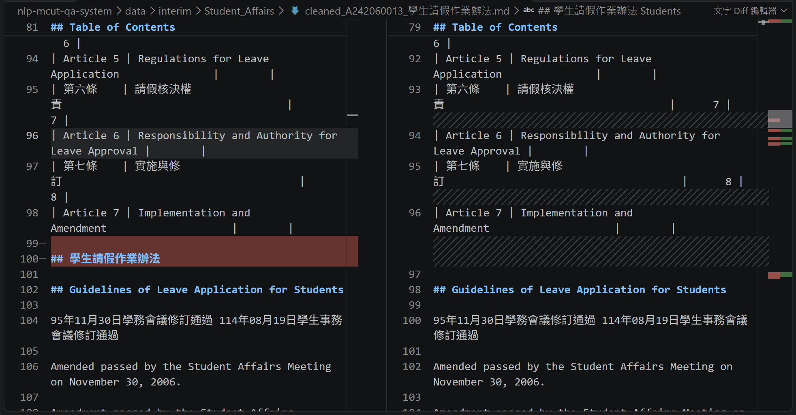
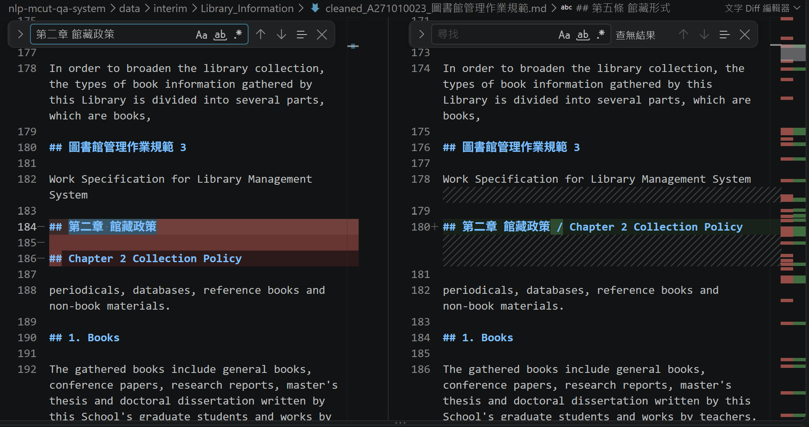
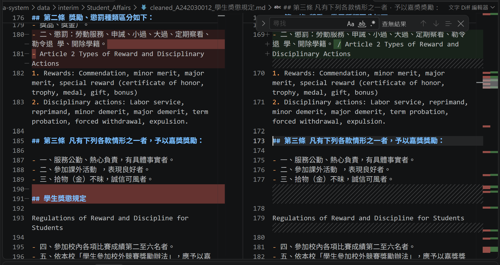
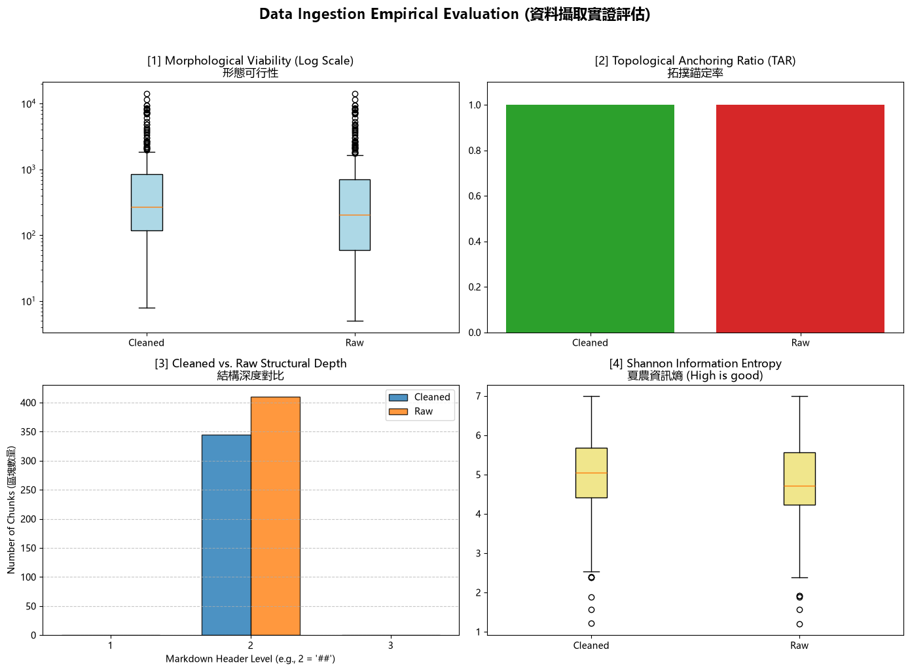

# 資料前處理報告 (Data Preparation Report)

- **學號 / 姓名**：U12627031 / 黃一展
- **專案名稱**：nlp-mcut-qa-system
- **完成的任務**：- [x] 1-A 頁首頁尾清除　- [x] 1-B 雙語標題合併　- [x] 1-C 雙語條文合併

---

## 1. 資料集概覽 (Dataset Overview)

| 類別 (Cluster) | PDF 數量 | 清洗前 chunk 數 | 清洗後 chunk 數 |
|---|---|---|---|
| Academic_Affairs | 3 | 96 | 65 |
| Library_Information | 3 | 248 | 225 |
| Student_Affairs | 3 | 66 | 55 |
| **合計** | 9 | 410 | 345 |

**問題 (2–3 句)：** 清洗後 chunk 數量變少了多少？是哪個任務造成的？有沒有哪個任務**不影響** chunk 數量？為什麼？

清洗後 chunk 數量共減少了 65 個（從 410 個減少至 345 個）。這主要是由任務 1-A（刪除各頁重複出現的 `## 法規名稱` 頁首）與任務 1-B（將中文 `## 標題` 與英文 `## Title` 合併為單一標題，消除了第二個 `##` 標記）所造成的。任務 1-C 則**完全不影響** chunk 數量，因為切塊規則（`chunking_regex`）是依據 `\n(?=##\s)` 二級標題進行切割，而任務 1-C 僅合併條文清單項（`- 條文 / Clause`），並未增刪任何 `## ` 標題，因此不會改變 chunk 的總數與邊界。

---

## 2. 清洗步驟 (Cleaning Steps)

### 2.1 任務 1-A：頁首頁尾溢出清除

- 檔名：`Student_Affairs/raw_A242060013_學生請假作業辦法.md`（對照 `cleaned_A242060013_學生請假作業辦法.md`）　搜尋的文字：`學生請假作業辦法` (約第 100 行)
- 截圖 (存為 `reports/figures/1a_compare.png`)：
- 改變了什麼：移除了第 2 頁頂端重複溢出的規章標題頁首（`## 學生請假作業辦法`）。
- 這對之後的問答檢索有什麼幫助：避免檢索器將跨頁頁首標題誤認為新的法規章節或產生碎片切塊，確保目錄表格與後續條文保持連貫，提升檢索召回精準度。
- 這個任務有沒有**改錯**的地方 (把不該改的也改了)？若有，寫出檔名與搜尋的文字；若沒有，寫「沒有發現」：沒有發現

### 2.2 任務 1-B：雙語標題合併

- 檔名：`Library_Information/raw_A271010023_圖書館管理作業規範.md`（對照 `cleaned_A271010023_圖書館管理作業規範.md`）　搜尋的文字：`第二章 館藏政策` (約第 184 行)
- 截圖 (存為 `reports/figures/1b_compare.png`)：
- 改變了什麼：將中文章名 `## 第二章 館藏政策` 與其後的英文章名 `## Chapter 2 Collection Policy` 合併為單一雙語標題 `## 第二章 館藏政策 / Chapter 2 Collection Policy`。
- 這對之後的問答檢索有什麼幫助：避免英文標題自成一個無實質內容的空 chunk；合併為同一標題後能同時保留中英文關鍵字，使後續 RAG 支援跨語言（中英雙語）語意檢索時皆能準確錨定。
- 這個任務有沒有**改錯**的地方 (把不該改的也改了)？若有，寫出檔名與搜尋的文字；若沒有，寫「沒有發現」：沒有發現

### 2.3 任務 1-C：雙語條文合併

- 檔名：`Student_Affairs/raw_A242030012_學生獎懲規定.md`（對照 `cleaned_A242030012_學生獎懲規定.md`）　搜尋的文字：`二、懲罰：勞動服務` (約第 180 行)
- 截圖 (存為 `reports/figures/1c_compare.png`)：
- 改變了什麼：將中文條文清單項與下一行的英文對應條文（`Article 2 Types of Reward and Disciplinary Actions`）合併為單一清單項，中間以 ` / ` 分隔中英文。
- 這對之後的問答檢索有什麼幫助：確保每條法規的中文條文與官方英文翻譯緊密綁定在同一個語塊內，無論使用者使用中文或英文提問，都能檢索出包含雙語對照的完整條文資訊，避免中英分散在不同區塊造成答案不完整。
- 這個任務有沒有**改錯**的地方 (把不該改的也改了)？若有，寫出檔名與搜尋的文字；若沒有，寫「沒有發現」：沒有發現

---

## 3. 評估指標與 AI 解讀查證 (Metrics & Verifying the AI's Interpretation)

### 3.1 指標數據表

| 指標 | Raw | Cleaned (你的) | Cleaned (參考值) |
|---|---|---|---|
| [1] 中位數長度 Median Length | 205.0 | 273.0 | 273.0 |
| [2] 拓撲錨定率 TAR | 1.0 | 1.0 | 1.0 |
| [3] 深度變異量 SDV (選填) | 0.0 | 0.0 | 0.0 |
| [4] 中位數資訊熵 Entropy (選填) | 4.72 | 5.05 | 5.05 |



**你的 Cleaned 結果與參考值一致嗎？** 一致，清洗後的各項指標與課堂基準完全吻合，驗證正則清洗邏輯全部正確落實。

### 3.2 AI 的解讀

- 使用的 AI 工具：Antigravity (Gemini 3.8 Flash)

```text
這份四拼圖儀表板展現了資料清洗前後的結構與語意品質變化：

1. 形態可行性 (Median Length)：清洗前 Raw 的中位數長度為 205 字元，分布較為零散且偏向短碎片；清洗後 Cleaned 的中位數長度提升至 273 字元，長度分布更加飽滿集中，表明原本分散的標題與雙語條文已成功整合成語意完整的區塊。
2. 拓撲錨定率 (TAR Score)：無論清洗前後皆維持 1.0 (100%) 的完美錨定率，表示每個切塊皆成功以規範的二級標題 (## ) 作為開頭，無任何孤立或失錨的游離文字。
3. 深度變異量 (Depth Variance SDV)：清洗前後皆保持 0.0，顯示切塊的層級深度結構非常均勻穩定。
4. 夏農資訊熵 (Information Entropy)：中位數資訊熵由 Raw 的 4.72 提升至 Cleaned 的 5.05。這表示在合併中英雙語對照並去除多餘空白與頁首贅字後，單一 chunk 內的字元多樣性與有效資訊密度顯著增加。
```

### 3.3 你的查證 (至少兩點)

**查證 1**
- AI 的說法：夏農資訊熵中位數從 4.72 提升至 5.05，代表清洗後合併了中英雙語對照，單一 chunk 內的字元多樣性與資訊密度顯著增加。
- 我查了什麼 (哪個檔案、哪個 chunk、哪段程式)：查閱 `metrics.json` 與 `data/interim/Student_Affairs/cleaned_A242030012_學生獎懲規定.md` 第 173 行的條文合併結果。
- 結論：正確，因為任務 1-C 將原先獨立的中文條文與英文翻譯合併到同一個條文清單項中，單一 chunk 內同時包含了繁體漢字、英文字母與標點符號，相較於只有純中文或純英文的零散區塊，字元出現的分布多樣性提高，因此計算出的夏農資訊熵自然上升。

**查證 2**
- AI 的說法：拓撲錨定率 (TAR Score) 在清洗前後皆維持 1.0 (100%)，表示每個切塊皆成功以二級標題 (## ) 作為開頭，無任何孤立或失錨文字。
- 我查了什麼：查閱 `notebooks/01_Data_Ingestion.ipynb` 第 5 節的切塊規則 `chunking_regex = r'\n(?=##\s)'` 以及 `metrics.json`。
- 結論：正確，因為切塊規則採用正向預查 `\n(?=##\s)`，以嚴格的二級標題語法做為切分依據，這使得產出的所有 chunk 其首行必定帶有 `## ` 標題，因此計算拓撲錨定率時所有 chunk 皆符合條件，得分必然為 1.0。

### 3.4 實際證據：你被指定的 chunk

- **SEED**：1106

**(a) 很長的 chunk**
- 資料檔 (JSON)：`data/processed/Library_Information/cleaned_A271010023_圖書館管理作業規範_processed.json`　位置：第 1 個 (從 0 開始數)　長度：6075 字元　驗證碼：b8bb6a66
- 閱讀用檔案 (`.md`)：`data/interim/Library_Information/cleaned_A271010023_圖書館管理作業規範.md`　從第 5 行開始
- 前 3 行內容：
  ```text
  ## Ming

  Work Specification for Library Management System
  ```
- 這是什麼樣的文字？為什麼會這麼長？這是該法規卷首的修訂紀錄歷程與章節目錄。長達 6075 字元的原因在於它完整收錄了民國 86 年至 113 年間數十次委員會議的修訂紀錄文字區塊，以及第 1 至 12 章的章節名稱與目錄頁次對照表，全部被歸在同一個 `## ` 標題底下。
- 之後做問答檢索時，這麼長的 chunk 可能造成什麼問題？此長度遠超一般語意 Embedding 模型（通常上限為 512 tokens）的有效上下文長度，會導致後段文字語意遭強制截斷或向量被嚴重稀釋；在 RAG 檢索生成時傳回此 chunk 會佔用大量 prompt token，稀釋具體規範內容並增加幻覺風險與推論延遲。

**(b) 資訊熵很低的 chunk**
- 資料檔 (JSON)：`data/processed/Library_Information/cleaned_A271010023_圖書館管理作業規範_processed.json`　位置：第 158 個 (從 0 開始數)　資訊熵：3.09　驗證碼：c9596b73
- 閱讀用檔案 (`.md`)：`data/interim/Library_Information/cleaned_A271010023_圖書館管理作業規範.md`　從第 1773 行開始
- 內容：
  ```text
  ## 總冊數：

  總金額：
  ```
- 為什麼它的資訊熵這麼低？它對問答檢索有用嗎？因為全文僅有 13 個字元，字元組成極其簡單且無實質敘述文字，字元種類極少，導致資訊熵低至 3.09。它對問答檢索完全無用，因為這只是表單底部的欄位抬頭，不包含任何法規實體規則與數值，在 RAG 檢索時被召回只會形成無意義的噪音干擾。

---

## 4. 一個尚未解決的問題 (One Remaining Problem)

- **檔名** (`cleaned_*.md`)：`cleaned_A271010023_圖書館管理作業規範.md`　**從第 259 行開始**　**標題**：`## criticism.`
- **我是怎麼找到的** (例如：搜尋了什麼、看了哪個檔案)：在 `cleaned_A271010023_圖書館管理作業規範.md` 檢查異常短小且以 `##` 開頭的 chunk 時發現。
- **問題 chunk (貼上部分內容)**：

```text
## criticism.
```

- **問題是什麼**：原本位於第 257 行的英文完整句子「...submit it to the academic year library committee meeting for self-criticism.」在轉檔時遭換行切斷，句尾的「criticism.」被誤判定為 Markdown 二級標題（`## criticism.`），導致上半句留在前一個 chunk，而句尾單字 `criticism.` 獨立變成一個僅有單字的畸形 chunk。
- **可能的原因** (PDF 本身？Docling 轉換？清洗的正則表示式？切塊規則？)：原始 PDF 中該行因排版換行落於行首或帶有微小字級差異，Docling 轉換時錯誤套用了 Heading 2 標記；且現有切塊規則 `\n(?=##\s)` 盲目依據 `##` 下刀切割，缺乏標題合法性檢驗，導致殘缺單字獨立成塊。
- **具體的修正方法**：在前處理管線中加入標題合法性防禦正則：當 `##` 後方的文字為小寫英文單字、長度過短且前一行以破折號 `-` 結尾時，移除 `##` 並自動與前一行文字接合；或在切塊後加入長度門檻檢查（如字元數 < 20 且非合法法規條文者強制與相鄰 chunk 合併）。
- **對問答檢索的影響**：前一個 chunk 的英文條文失去句尾（停在 `for self-`），語意不完整；而獨立的 `criticism.` chunk 毫無語意上下文，若檢索被匹配將消耗 LLM 上下文空間並提供零效益資訊。

---

## 5. AI 協作 (AI Collaboration)

- 本次作業的 AI 協作紀錄請見 [`AI_USAGE.md`](AI_USAGE.md) 的「Week 04 / 08」與「Week 09」段落。
- 這次使用 AI 最大的收穫或教訓是：在依賴 AI 設計正則表達式時，不能只提供正向案例，必須明確要求 AI 考慮「邊界防禦與反例約束（例如中英文交錯標題、表單欄位被 OCR 誤判為標題的情況）」；同時必須透過 `metrics.json` 與實際查閱極端值 chunk 親自驗證，才能發現如 `## criticism.` 這種由 PDF 排版轉檔引發的深層語意斷裂問題。
